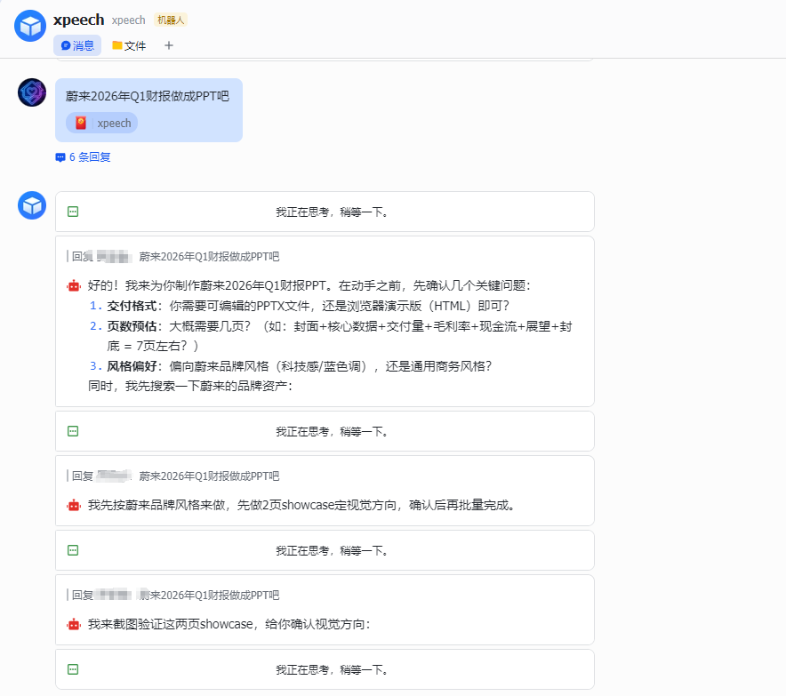
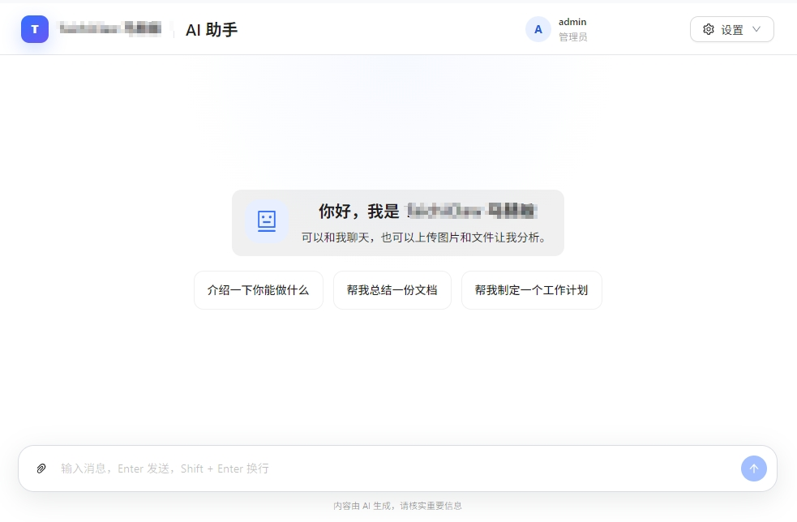
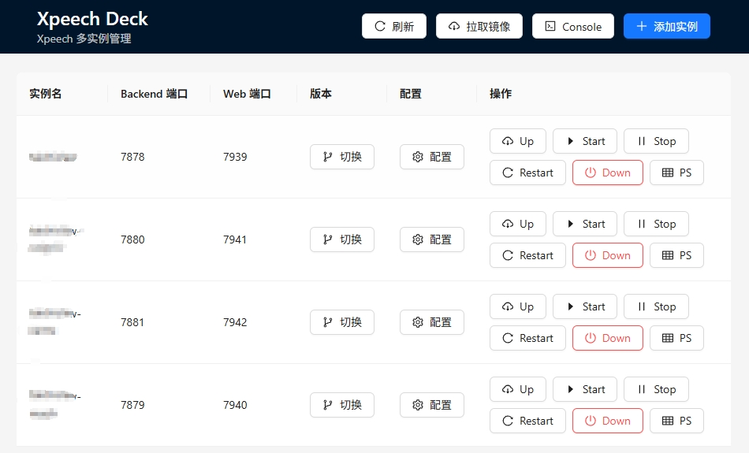

<p align="center">
  
</p>

<h1 align="center">Xpeech</h1>

<p align="center">
  <strong>Xpeech Super Agent</strong><br>
  Reject all complex concepts and keep it simple.
</p>



Xpeech 提供 `/chat` HTTP API 和 SSE 流式响应，支持文本、图片、视频和文件输入，可调用大模型及工具完成任务。项目包含 Agent 后端、Web 客户端、飞书渠道和 Lark 令牌管理服务，可用于搭建独立的 AI Agent 服务或接入现有业务系统。

## 核心功能

- 多模态对话、多轮会话和按用户隔离的工作区
- 会话历史、自动上下文压缩和长期记忆
- 文件、Shell、网页搜索与抓取、Office 文档等内置工具
- 自定义 Python 工具、MCP Server 和技能扩展
- Web 客户端、飞书消息桥接及飞书定时任务
- 基于 JWT 的通道认证，以及按通道、用户和组织过滤资源
- PostgreSQL 对话记录、使用统计和数据大屏
- Docker Compose 一键部署完整服务

## 快速开始

### 环境要求

- Python 3.12+
- [uv](https://docs.astral.sh/uv/)
- PostgreSQL
- Redis 6.2+（模型全局并发控制和共享缓存）
- Linux 下使用 Shell 和 stdio MCP 时，需要 bubblewrap 和 slirp4netns

安装依赖并创建配置：

```bash
uv sync
cp conf.toml.example conf.toml
```

编辑 `conf.toml`，配置模型、PostgreSQL、Redis 及 JWT 密钥。完整配置说明见 [AGENTS.md](AGENTS.md)。

启动 API 服务：

```bash
uv run -m xpeech
```

默认地址：

- API：http://localhost:7878
- Swagger UI：http://localhost:7878/docs
- Web 客户端：http://localhost:7939（需单独启动并构建前端）

Web 客户端、飞书渠道、令牌管理器及前端构建方式见[详细文档](AGENTS.md)。

## Docker Compose

```bash
cp conf.toml.example conf.toml
cp .env.example .env
docker compose up -d --build
```

启动前请填写 `conf.toml` 中的模型密钥、数据库连接、三组 JWT 密钥和所需的飞书配置，并按需修改 `.env` 中的初始化参数和端口。

Compose 包含后端、Nginx、Web 客户端、飞书渠道、Lark 令牌管理器、PostgreSQL 和 Redis。副本数、端口、数据目录及升级注意事项见[部署文档](AGENTS.md#docker-compose-部署)。

## Redis 共享状态

静态配置继续保存在 `conf.toml`。backend、Web 和飞书应连接同一个 `[redis]` 数据库：

- `llm.parallel` 限制全集群所有模型调用的总并发，例如 8 个 backend、`parallel = 4` 时总上限为 4。本地信号量与 Redis 租约配合，覆盖整个流消费过程；租约 60 秒，每 15 秒续租，进程崩溃后自动过期。Redis 不可用时拒绝新模型请求，续租失败则停止对应请求。
- 用户组织、姓名和元数据共用原始 JSON 查询缓存，TTL 为 3600 秒，按用户 ID、命令及 claim 配置的哈希隔离。查询失败、超时和无效 JSON 不缓存。
- 统计查询按数据库身份、方法及完整参数共享缓存，TTL 为 5 秒。两类缓存通过 Redis 租约合并相同查询；Redis 故障时记录告警并直接查询数据源。

`llm.api_key` 只接受一个 Key，逗号分隔的多 Key 配置会报错，不再轮询。Nginx 按用户粘性路由继续保留，用户绑定实例的状态仍由所属实例管理。

## Web 客户端

内置 Web 聊天客户端，支持账号及 OAuth2 登录、多会话、历史消息、数据统计和 iframe 嵌入。



## 快速部署平台

如果需要通过可视化界面快速部署和集中管理一个或多个 Xpeech 实例，可以使用
[Xpeech Deck](https://github.com/luojiaaoo/xpeech-deck)。它会为每个实例维护独立的 Xpeech Git
工作树和 Docker Compose 环境，并提供：

- 创建 Xpeech 实例，自动更新并在远程分支、标签和近期提交之间切换版本
- 在线配置 Backend / Web Client 端口、`conf.toml` 和自定义内置技能
- 执行 Up、Start、Stop、Restart、Down 和 PS 等常用 Docker Compose 操作
- 检查和拉取 Xpeech 所需镜像，通过 System Console 查看命令及执行结果



Xpeech Deck 是自托管平台，需要与 Docker 和所有受管 Xpeech 实例运行在同一台机器上。
安装、配置和访问方式请参阅 [Xpeech Deck 使用说明](https://github.com/luojiaaoo/xpeech-deck#readme)。

## 文档

- [详细配置、部署与开发文档](AGENTS.md)
- [后端接入说明](docs/backend-integration.md)：聊天、SSE、追问和文件接口
- [iframe 嵌入接入](docs/iframe-integration.md)
- [Web 客户端说明](xpeech/subapp/channel/web_client/README.md)

## 开发

```bash
uv sync
uv run pytest
```

项目结构、测试环境、工具安全、沙盒实现及各模块的详细约定见 [AGENTS.md](AGENTS.md)。
